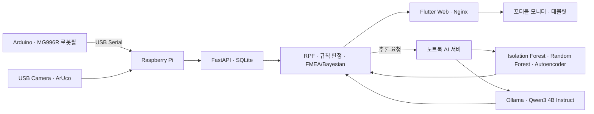

# CausalRoboQC

## 간단한 소개

CausalRoboQC는 로봇 작업 데이터를 제품 단위의 Robot-Process Fingerprint(RPF)로 연결하고,
검사 우선순위·보조 분석 지표·원인 후보·점검 정보를 제공하는 AI 제조 품질관리 시스템이다.

제품별 작업 순서, 단계 시간, 재시도, 오류와 작업자 개입을 RPF로 저장하고,
규칙 기반 등급과 ML/DL 분석, FMEA·Bayesian Network, 로컬 AI 코파일럿을 하나의 웹앱에 통합한다.

**2026 충청 ICT 이노베이션스퀘어 개발 역량 강화 멘토링 본선 진출작**  
팀 Double Click · 김정윤

## 주요 기능

| 기능 | 내용 |
| --- | --- |
| 제품별 RPF | 제품 1개를 RPF 1건으로 관리하고 반복 실행은 Cycle별로 분리한다. |
| 규칙 기반 등급 | 정상·확인 필요·우선검사 등급과 판정 근거를 제공한다. |
| 로봇 제어 | Arduino·MG996R 로봇팔의 포즈, Run, 반복 실행과 STOP·ESTOP·RESET·DETACH를 지원한다. |
| 카메라·ArUco | `DICT_4X4_50`, normalized ROI, ID 잠금·가림 유지와 Pick/Place 확인을 지원한다. |
| ML/DL 분석 | Isolation Forest, Random Forest, Autoencoder로 공정 이상도·검사 위험도·단계 시간 이상도를 계산한다. |
| 원인 후보 | FMEA와 discrete Bayesian Network로 기록된 이벤트에 따른 원인 후보와 점검 항목을 제공한다. |
| 실제 검사 결과 | PASS/FAIL, 확인 원인, 조치, 메모와 검사 시각을 규칙 등급과 분리해 저장한다. |
| 데이터 활용 | 기간·제품군·등급·제품 ID 필터, 제품 상세와 CSV Export를 제공한다. |
| AI 코파일럿 | Ollama 기반으로 제품 설명·비교·기간 분석·그래프·원인 후보·보고서·사용법 질문을 처리한다. |
| 현장 배포 | Raspberry Pi, Nginx, Docker Compose, 포터블 모니터와 노트북 AI 서버의 분리 구성을 지원한다. |

## 시스템 구성



| 장치 | 역할 |
| --- | --- |
| Arduino·MG996R 로봇팔 | 제품 Pick & Place, 포즈 이동과 작업 이벤트 전송 |
| Raspberry Pi | FastAPI, SQLite, OpenCV·ArUco, RPF·규칙 판정, Flutter Web 운영 |
| 노트북 | ML/DL 추론 서버와 Ollama AI 코파일럿 실행 |
| 포터블 모니터·태블릿 | Raspberry Pi 또는 노트북의 Flutter 웹앱 표시 |

## RPF 처리 흐름

1. 입력 ROI에서 동일한 ArUco ID가 연속 검출되면 활성 제품 ID를 잠근다.
2. Run 시작 시 마커 ID를 해당 Cycle의 RPF에 연결한다.
3. 로봇에 마커가 가려져도 활성 ID를 유지한다.
4. LIFT 이후 제품이 입력 ROI에서 사라지면 `PICK_VERIFIED`를 기록한다.
5. RELEASE 이후 동일 ID가 출력 ROI에서 안정적으로 확인되면 `PLACE_VERIFIED`를 기록한다.
6. 다른 ID가 확인되면 `PRODUCT_ID_MISMATCH`, 제한시간을 넘기면 `PLACE_TIMEOUT`으로 실패 처리한다.
7. 완료된 RPF에 규칙 기반 등급을 적용하고 기존 ML/DL 서버로 자동 분석을 요청한다.
8. 작업자는 제품 상세에서 분석값·원인 후보·점검 순서와 실제 검사 결과를 확인하거나 저장한다.

ArUco와 ROI는 제품 식별과 Pick/Place 확인의 시각적 근거로 사용한다.
별도 위치 보정이 없는 상태에서 mm 단위 위치 오차나 회전 오차를 생성하지 않는다.

## 권장 실행 환경

| 구분 | 권장 환경 |
| --- | --- |
| Raspberry Pi | 64-bit Linux, Docker, Docker Compose, USB Serial, USB Camera |
| 노트북 | Ubuntu 22.04, Python 3.10, Ollama, `qwen3:4b-instruct` |
| 웹앱 빌드 | Flutter SDK |
| 카메라 | OpenCV에서 접근 가능한 `/dev/video*` 장치 |
| 로봇팔 | Arduino와 MG996R 6축 로봇팔, `/dev/ttyACM*` 또는 설정한 Serial 장치 |
| 네트워크 | 노트북 핫스팟 또는 동일한 로컬 네트워크 |

## 저장소 구조

| 경로 | 역할 |
| --- | --- |
| `robot_arm/` | Arduino·MG996R 로봇팔 제어와 포즈 설정 |
| `server/app/` | FastAPI, SQLite, Serial, RPF, 비전, inspection, FMEA·Bayesian |
| `server/config/` | 포즈, RPF 규칙, 비전 ROI, FMEA·Bayesian 설정 |
| `ai/` | IF·RF·Autoencoder 추론 API와 Ollama 코파일럿 |
| `app/` | Flutter Web 대시보드·로봇 제어·품질관리·데이터 조회 |
| `scripts/` | 발표 실행, 노트북 AI, Pi 배포, kiosk와 검증 스크립트 |
| `docker-compose.pi.yml` | Raspberry Pi용 FastAPI·Nginx 배포 구성 |
| `deploy-examples/` | systemd 서비스 예시 |

## 설치

저장소를 받은 뒤 Python 환경과 모델을 준비한다.

```bash
git clone https://github.com/Jeong-Yun-Kim/CausalRoboQC.git
cd CausalRoboQC

python3 -m venv .venv
source .venv/bin/activate
python -m pip install --upgrade pip
python -m pip install -r server/requirements.txt -r ai/requirements.txt

ollama pull qwen3:4b-instruct
```

Flutter Web을 빌드할 시스템에서는 다음 명령도 실행한다.

```bash
cd app
flutter pub get
cd ..
```

## 발표용 단일 노트북 실행

RPF-001~RPF-030의 고정 데이터와 AI 서버, FastAPI, Flutter Web을 한 번에 실행한다.
발표 모드의 로봇 Run/Event는 유지하지만 품질 데이터 30건에는 새 RPF를 추가하지 않는다.

```bash
./scripts/run_presentation.sh
```

기본 접속 주소는 다음과 같다.

```text
Web App    http://127.0.0.1:8080
Robot API http://127.0.0.1:8000
AI Server http://127.0.0.1:9000
```

같은 네트워크의 태블릿에서 사용할 때는 노트북 IPv4 주소를 지정한다.

```bash
PRESENTATION_LAN_IP=192.168.0.10 ./scripts/run_presentation.sh
```

태블릿에서 `http://192.168.0.10:8080`으로 접속한다.

## Raspberry Pi 분리 실행

### 1. 노트북 AI 서버

```bash
./scripts/run_notebook_ai.sh --start
```

AI 서버는 `0.0.0.0:9000`에서 실행하며 Raspberry Pi가 로컬 네트워크로 접근한다.

### 2. Flutter Web 빌드

```bash
cd app
flutter build web --release --no-web-resources-cdn --dart-define=API_BASE_URL=/
cd ..
```

### 3. Raspberry Pi 설정

```bash
cp .pi.env.example .pi.env
```

`.pi.env`에서 장치 경로와 노트북 주소를 실제 환경에 맞춘다.

```dotenv
SERIAL_DEVICE=/dev/ttyACM0
CAMERA_DEVICE=/dev/video0
VISION_ENABLED=true
VISION_REQUIRED=true
CAMERA_PREVIEW_MODE=server
ANALYSIS_BASE_URL=http://192.168.0.10:9000
PRESENTATION_MODE=false
```

장치와 실행 명령을 먼저 확인한다.

```bash
./scripts/run_pi.sh --check
```

FastAPI와 Flutter Web을 실행하고 상태를 확인한다.

```bash
./scripts/run_pi.sh --start
./scripts/run_pi.sh --health
```

접속 주소는 다음과 같다.

```text
Pi 직접 연결 모니터  http://127.0.0.1:8080
같은 네트워크 태블릿 http://<Pi_IP>:8080
FastAPI              http://<Pi_IP>:8000
```

포터블 모니터에서 Chromium을 키오스크로 실행한다.

```bash
./scripts/kiosk.sh --start
```

## 주요 환경변수

| 환경변수 | 기본값 | 역할 |
| --- | --- | --- |
| `SERIAL_DEVICE` | `/dev/ttyACM0` | Arduino Serial 장치 |
| `CAMERA_DEVICE` | `/dev/video0` | OpenCV 카메라 장치 |
| `VISION_ENABLED` | `false` | ArUco 비전 기능 사용 |
| `VISION_REQUIRED` | `false` | 비전 준비 실패 시 Run 차단 |
| `VISION_CONFIG_PATH` | `server/config/vision.json` | ROI·안정 프레임·timeout 설정 |
| `CAMERA_PREVIEW_MODE` | `browser` | `browser`, `server`, `off` 중 선택 |
| `ANALYSIS_BASE_URL` | `http://127.0.0.1:9000` | ML/DL 분석 서버 주소 |
| `PRESENTATION_MODE` | `false` | 발표 전용 RPF 30건 고정 모드 |
| `OLLAMA_MODEL` | `qwen3:4b-instruct` | AI 코파일럿 모델 |

## 분석 방법

| 구분 | 방법 | 출력 |
| --- | --- | --- |
| 기본 등급 | 규칙 기반 | 정상·확인 필요·우선검사 |
| 공정 이상도 | Isolation Forest | 정상 공정 대비 특이도 |
| 검사 위험도 | Random Forest | 추가 검사 우선순위 보조 점수 |
| 공정 단계 시간 이상도 | Autoencoder | 7단계 시간 패턴 차이 |
| 원인 후보 | FMEA + discrete Bayesian Network | 원인 후보 posterior와 점검 항목 |
| 작업자 설명 | Ollama Local LLM | 설명·비교·그래프·보고서·사용법 |

규칙 기반 등급이 기본 판정이며 ML/DL·Bayesian 결과는 이를 변경하지 않는다.
현재 ML/DL 모델은 합성 학습 데이터 기반 시험 모델이다.
FMEA/Bayesian prior와 CPT도 명시적으로 설정한 가정이며 실제 불량 확률이나 원인 확정값이 아니다.

## 검증

소프트웨어 검증은 다음 명령으로 실행한다.

```bash
source .venv/bin/activate
python scripts/test_software.py

cd app
flutter analyze
flutter test
flutter build web --release --no-web-resources-cdn --dart-define=API_BASE_URL=/
```

검증 결과:

- Python 테스트 96개 통과
- Flutter 테스트 37개 통과
- `flutter analyze`, Web release build 통과
- Playwright fixture 기반 주요 화면·비전·inspection 흐름 통과
- Raspberry Pi, Arduino·MG996R 로봇팔, USB 카메라, 노트북 AI 서버와 웹앱의 실기기 통합 동작 확인
- ArUco ID 잠금·가림 유지, Pick/Place 확인, RPF 완료와 분석 연동 확인
- 로컬 네트워크와 포터블 화면 접속 확인

장치 경로, ROI, 조명, 마커 크기와 네트워크 주소는 설치 환경에 맞게 조정해야 한다.

## 프로젝트 성과

- 2026 충청 ICT 이노베이션스퀘어 개발 역량 강화 멘토링 본선 진출
- 로봇 작업 이벤트를 제품 단위 RPF로 구조화
- 규칙 판정·ML/DL·FMEA/Bayesian·로컬 LLM을 하나의 품질관리 흐름으로 통합
- 실제 카메라·로봇팔·Raspberry Pi·노트북 AI 서버·웹앱 통합 검증
- 실제 검사 결과를 RPF와 분리 저장하고 이후 재학습에 사용할 수 있는 구조 구현

## 참고

- 발표 환경과 상세 동작: [`ai/PRESENTATION.md`](ai/PRESENTATION.md)
- Raspberry Pi 설정 예시: [`.pi.env.example`](.pi.env.example)
- 비전 설정: [`server/config/vision.json`](server/config/vision.json)
- FMEA·Bayesian 설정: [`server/config/fmea_bayesian.json`](server/config/fmea_bayesian.json)
